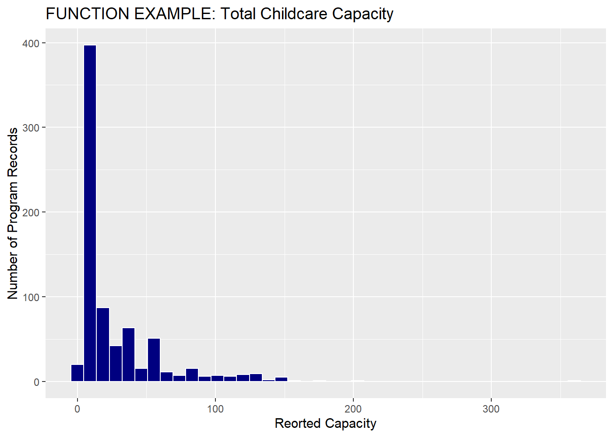
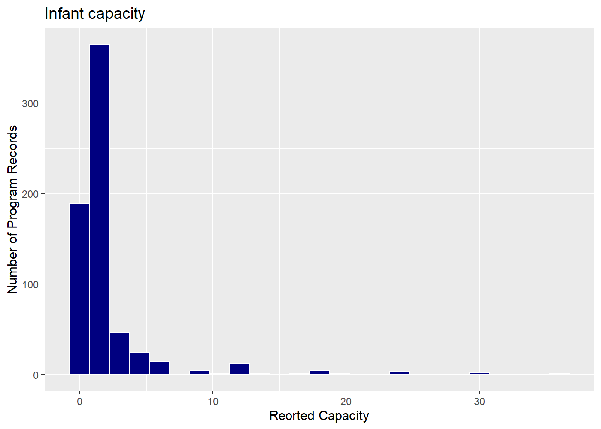
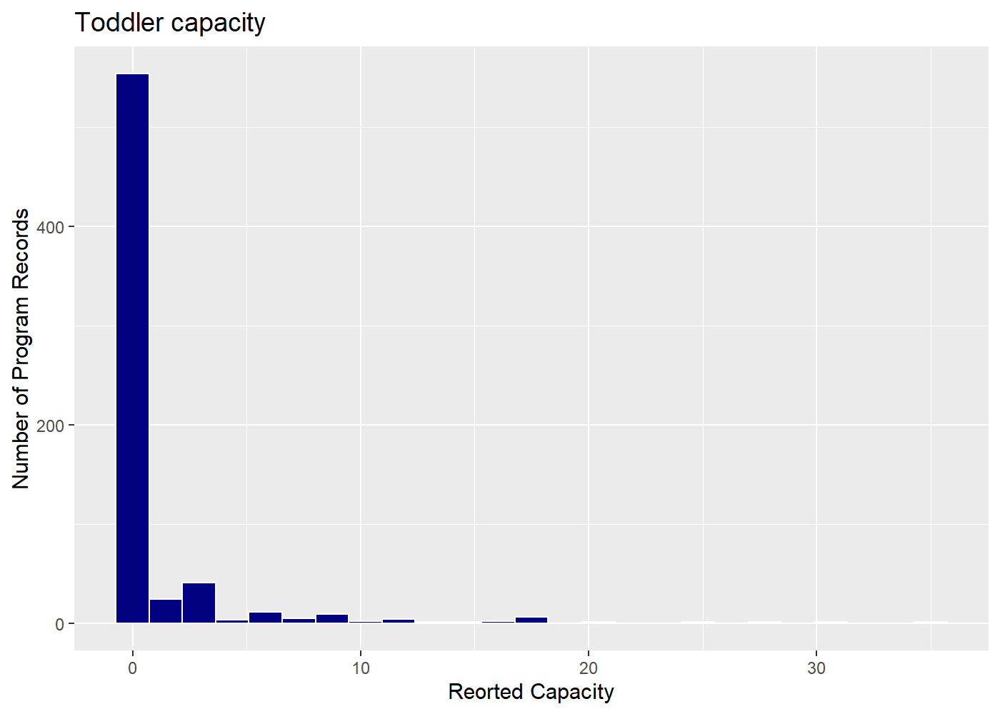
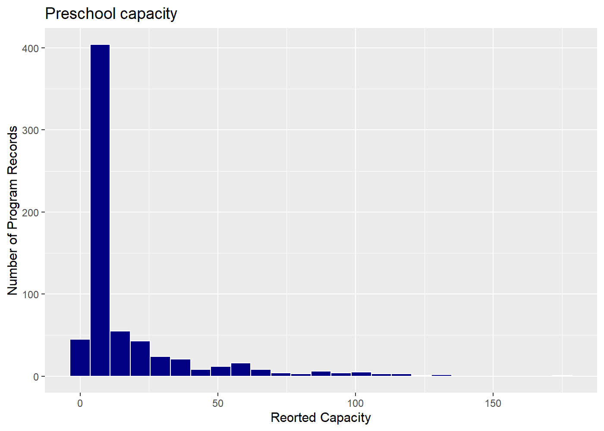
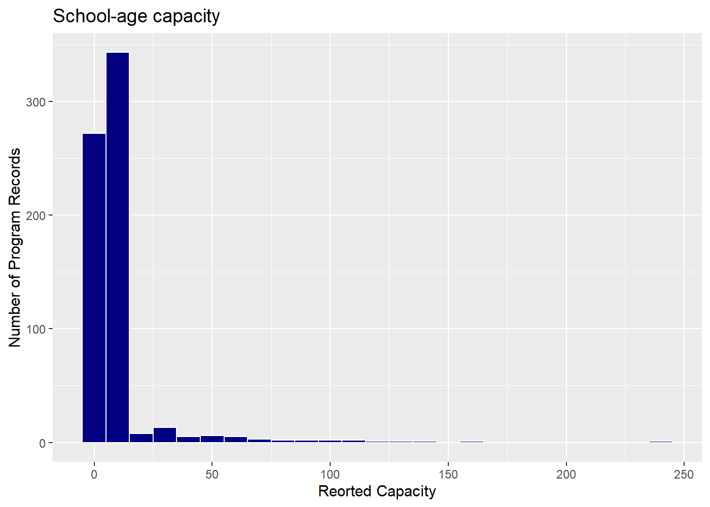
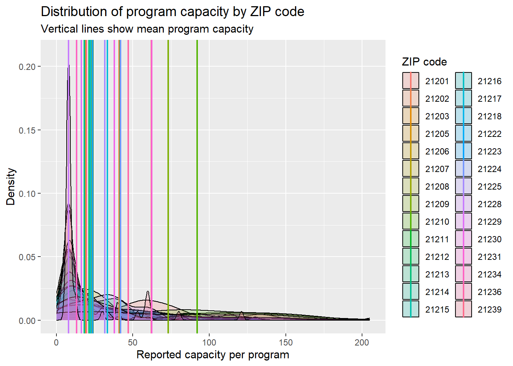
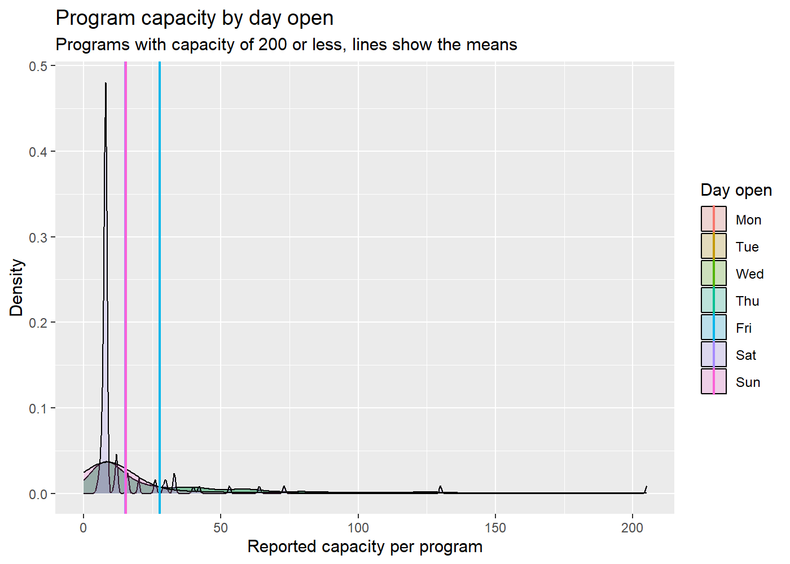
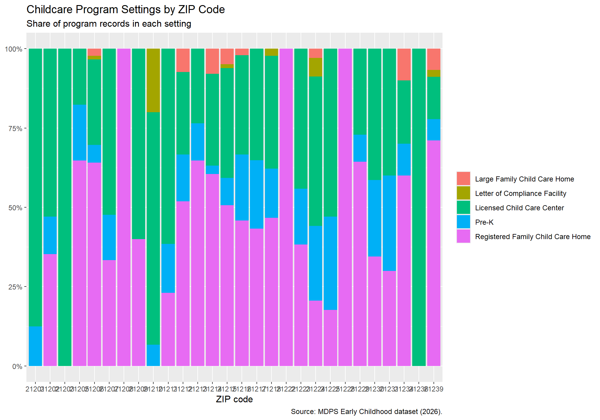

# MDPS Early Childhood Development, EDA
Keaton Green

# MDPS Early Childhood Development

For this project, I’m interested in how reported childcare capacity
varies across Baltimore ZIP codes. I’ll explore the MDPS Early Childhood
data to compare program records, program settings, and capacity for
different age groups. I’ll also check missing information and repeated
addresses before interpreting the comparisons.

I want to see how childcare programs and their reported capacity vary
across Baltimore ZIP codes. I’m also interested in whether different
program settings have different schedules and serve different age
groups.

I’m starting by looking through the table, checking what needs cleaning,
and trying a few charts. I’m using the course’s EDA notes to help
organize the process. At this point, I’m looking for patterns and
figuring out which comparisons are actually useful.

1.  Inspect the columns and clean the data.
2.  Check missing information and possible duplicate records.
3.  Summarize childcare capacity by ZIP code.
4.  Compare program counts, capacities, and program settings.
5.  Write short notes about the patterns in the results.

The original plan was to use the cities Real_Property data for a cross
examination. When this didnt work the file was deleted but since it was
still attached to the dataset but it was to large to push. ChatGPT was
used to fix this issue as i needed to go type in the terminal to direcly
interact with Bash.

Prompt, I had trouble pushing my midterm repository to GitHub because
data/Property_Information.csv was to large, exceeding GitHub’s 100 MB
limit. I deleted it, it remained in the history of six unpushed commits
how do i fix?

ChatGPT Response, Fix by typing this in terminal, git branch
backup-before-cleanup git reset –soft origin/main git commit -m “Add
childcare data and updated EDA” git push origin main

Starting by using https://umbc-viz.github.io/ges778/notes/05_eda.html to
structure this EDA. First, I’m loading the packages and making a working
copy of the data. I’m removing rows without an address so I can focus on
the program records.

# Setup

``` r
library(ggplot2)
library(dplyr)
```

These are the libraries used if not already installed use
install.packages().

``` r
childcare_eda <- read.csv("../data/MDPS Early Childhood Dev.csv",
  stringsAsFactors = FALSE
) |>
  filter(
    !is.na(address),
    address != ""
  )
```

The original table had seven footnote rows at the bottom. Filtering out
rows without addresses lets me keep those notes in the original file
without including them in the analysis.

``` r
# chunk option results='hide', results to long. 

dim(childcare_eda)
names(childcare_eda)
summary(childcare_eda)
```

These are quick checks of the table’s size, column names, and values.
They help me get familiar with the data, but I need to dig deeper before
deciding what is worth graphing.

# Summary

``` r
childcare_eda |> 
  dplyr::count(gen_program_setting_detail, sort = TRUE)
```

             gen_program_setting_detail   n
    1 Registered Family Child Care Home 371
    2        Licensed Child Care Center 260
    3                             Pre-K  98
    4      Large Family Child Care Home  17
    5     Letter of Compliance Facility   9

This is a very important part of the data and will be a key aspect to
one of the graphs. The settings gives us a detailed overview of the
programs, I looked at he program types but since some had overlap with
others the data would’ve been misrepresented double assigning counts.

``` r
childcare_eda |> 
  dplyr::count(zipcode, sort = TRUE)
```

       zipcode  n
    1    21206 89
    2    21215 81
    3    21229 59
    4    21213 51
    5    21216 48
    6    21218 45
    7    21239 45
    8    21214 38
    9    21217 37
    10   21223 34
    11   21224 34
    12   21230 29
    13   21212 27
    14   21207 21
    15   21202 17
    16   21205 17
    17   21225 17
    18   21210 15
    19   21211 13
    20   21231 10
    21   21234 10
    22   21201  8
    23   21209  5
    24   21203  1
    25   21208  1
    26   21222  1
    27   21228  1
    28   21236  1

The count of program records in each ZIP code will be crucial. These
counts are the number of programs offered in the zip not there capacity.

# Histograms

``` r
capacity_histogram <- function(variable, bins = 40){ 
  ggplot(childcare_eda, aes(x = {{ variable }}))+
    geom_histogram(
      bins = bins, fill = "navy", color = "white"
    ) + 
    labs(
      x = "Reorted Capacity", y = "Number of Program Records"
    )
}

capacity_histogram(total_capacity_1) + 
  labs(title = "FUNCTION EXAMPLE: Total Childcare Capacity")
```



Since I want several similar histograms, I’m making a function so I can
change the column without rewriting the chart. The bins control how the
values are grouped into bars.

``` r
childcare_eda$Infant.Capacity.. <- as.numeric(
  as.character(childcare_eda$Infant.Capacity..)) 
capacity_histogram(Infant.Capacity.., bins = 25) +
  labs(title = "Infant capacity")

capacity_histogram(Center.Toddler.Capacity, bins = 25) +
  labs(title = "Toddler capacity")

capacity_histogram(Preschool.Capacity, bins = 25) +
  labs(title = "Preschool capacity")

capacity_histogram(School.Age..capacity..., bins = 25) +
  labs(title = "School-age capacity")
```









The Infant.Capacity code was not working properly since it wasn’t
numeric this was because the data set had footnotes in the bottom 7 rows
as next.Line 105 is us shifting the characters to numeric. I’m using
these to check the spread of capacities and see whether a few large
programs stand out from the smaller ones. Missing values are left out of
the histograms.

# Zipcodes

``` r
# https://umbc-viz.github.io/ges778/extras/summarizing.html

programs_zip <- childcare_eda |> 
  dplyr::filter(
    zipcode %in% c(zipcode),
    !is.na(total_capacity_1),
    total_capacity_1 <= 300
  ) |>
  dplyr::mutate(zipcode = as.character(zipcode)
  )

zip_avg <- programs_zip |>
  dplyr::group_by(zipcode) |>
  dplyr::summarise(capacity_mean = mean(total_capacity_1)
  )

zip_avg
```

    # A tibble: 28 × 2
       zipcode capacity_mean
       <chr>           <dbl>
     1 21201            62.1
     2 21202            40.9
     3 21203            47  
     4 21205            23.2
     5 21206            19.2
     6 21207            24  
     7 21208             8  
     8 21209            73.2
     9 21210            92  
    10 21211            41.8
    # ℹ 18 more rows

I’m keeping capacities of 300 or less this is to cover every program
capacity. I used zipcodes as the category since it was the best field to
aggregate too. I would’ve preferred to use neighborhoods and if i was to
develop further this would be the way.

If doing spatial analysis this can be developed further. The product of
this gives the average program capacity for each zipcode. These averages
can developed a solid comparison of program accessibility over space.

``` r
ggplot(
  programs_zip,
  aes(x = total_capacity_1, fill = zipcode)
) + 
  geom_density(alpha = 0.2)+
  geom_vline(
    aes(xintercept = capacity_mean, color = zipcode),
    data = zip_avg,
    linewidth = 0.7
  ) + 
  labs(
    title = "Distribution of program capacity by ZIP code",
    subtitle = "Vertical lines show mean program capacity",
    x = "Reported capacity per program",
    y = "Density",
    fill = "ZIP code",
    color = "ZIP code"
  )
```

    Warning: Groups with fewer than two data points have been dropped.
    Groups with fewer than two data points have been dropped.
    Groups with fewer than two data points have been dropped.
    Groups with fewer than two data points have been dropped.
    Groups with fewer than two data points have been dropped.

    Warning: Removed 5 rows containing missing values or values outside the scale range
    (`geom_density()`).



This is not usable but has a good example of the data i wish to continue
examining. The curves show how program sizes are distributed within each
zipcodes, and the vertical lines show the averages.

# Schedules

``` r
program_day <- childcare_eda |>
  dplyr::filter(
    !is.na(total_capacity_1),
    total_capacity_1 <= 300
  ) |>
  tidyr::pivot_longer(
    cols = c(
      
      Monday.Open,
      Tuesday.Open,
      Wednesday.Open,
      Thursday.Open,
      Friday.Open,
      Saturday.Open,
      Sunday.Open
    ),
    names_to = "day",
    values_to = "open"
  ) |>
  dplyr::filter(open == "Yes") |>
  dplyr::mutate(
    day = factor(
      day,
      levels = c(
        "Monday.Open",
        "Tuesday.Open",
        "Wednesday.Open",
        "Thursday.Open",
        "Friday.Open",
        "Saturday.Open",
        "Sunday.Open"
      ),
      labels = c(
        "Mon",
        "Tue",
        "Wed",
        "Thu",
        "Fri",
        "Sat",
        "Sun"
      )
    )
  )

program_day_avg <- program_day |>
  dplyr::group_by(day) |>
  dplyr::summarise(
    capacity_mean = mean(total_capacity_1)
  )

program_day_avg
```

    # A tibble: 7 × 2
      day   capacity_mean
      <fct>         <dbl>
    1 Mon            27.8
    2 Tue            27.8
    3 Wed            27.8
    4 Thu            27.8
    5 Fri            27.8
    6 Sat            15.3
    7 Sun            15.4

I made these columns in the excel before bringing into here. The
time_days_open column was laid out with each day ex.
\[“Monday”,“Tuesday”,“Wednesday”,“Thursday”,“Friday”,“Saturday”,“Sunday”\]
this seemed unnecessarily difficult to adjust so the other columns were
made.

Before i started the analysis here in R i spent time making columns in
the table placing the days in the DAY.Open columns. I marked the days
they were open as yes/no based off if they gave a times for when
open/closed on that day. While not a chart this is showing a curve that
drops during the skews slightly in the middle of the week then drops off
during the weekend.

``` r
ggplot(
  program_day,
  aes(x = total_capacity_1, fill = day)
) +
  geom_density(alpha = 0.2) +
  geom_vline(
    aes(xintercept = capacity_mean, color = day),
    data = program_day_avg,
    linewidth = 0.7
  ) +
  labs(
    title = "Program capacity by day open",
    subtitle = "Programs with capacity of 200 or less, lines show the means",
    x = "Reported capacity per program",
    y = "Density",
    fill = "Day open",
    color = "Day open"
  )
```



This chart compares the sizes of childcare programs open on each day.
The x-axis shows reported capacity, the colors represent different days,
and the vertical lines show each day’s average program capacity. Its use
case seems limited as the data is so clustered the visualization isn’t
great.

Density shows where program sizes are concentrated. Using the capacity
we can find the averages for each day.The curves here are the percentage
of programs capacity on the different days. The massive spike shows that
on Saturday has 47% of its programs with a capacity of 5-10 spaces.

# Program Settings

``` r
program_setting_chart <- childcare_eda |>
  filter(!is.na(zipcode)) |>
  ggplot(
    aes(
      x = factor(zipcode),
      fill = gen_program_setting_detail
    )
  ) +
  geom_bar(position = "fill")

program_setting_chart +
  scale_y_continuous(labels = scales::percent) +
  labs(
    x = "ZIP code",
    y = NULL,
    fill = NULL,
    title = "Childcare Program Settings by ZIP Code",
    subtitle = "Share of program records in each setting",
    caption = "Source: MDPS Early Childhood dataset (2026)."
  )
```



# Footnotes

Looking through this, I’m becoming more interested in the relationship
between program setting and operating schedules. Registered family
childcare homes make up the largest group of records, followed by
licensed childcare centers. Among programs with capacity of 300 or less,
those reporting weekend operation have a lower average capacity than
those reporting weekday operation, around 15 spaces compared with 28. I
want to explore whether differences in program settings help explain
that pattern. These results describe reported programs and schedules,
though, rather than available openings or whether childcare meets local
demand.
