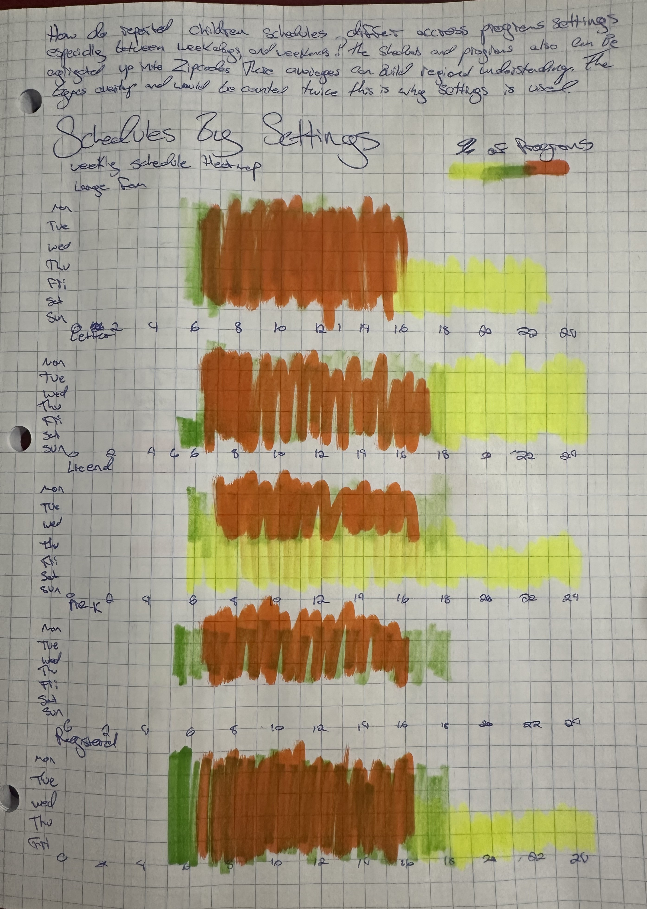
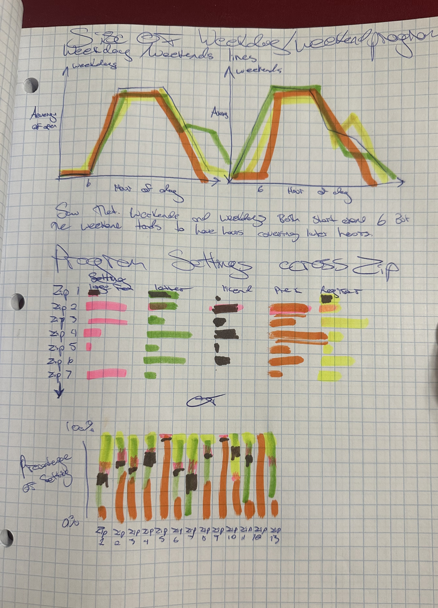
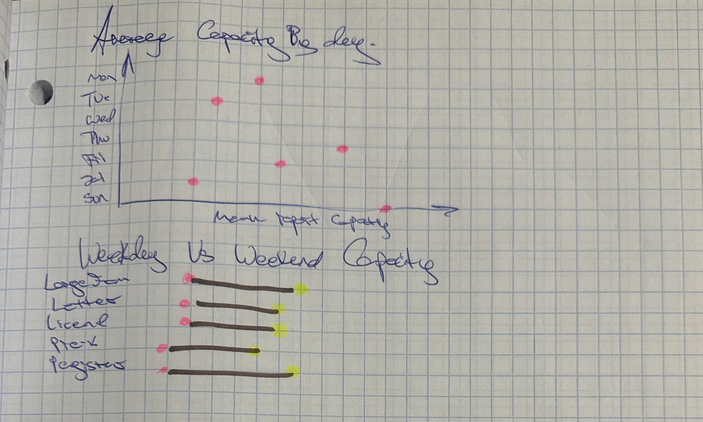

# Sketches

In my EDA, i had started the comparison of childcare capacity across zipcode, this let me examine more in depth the difference between program settings and their operating schedules. With that information i was able to sketch out the next steps,

My main question is how do reported childcare schedules form MDPS schedules differ across settings, especially between weekends and weekdays? I also like the idea of pairing these with zipcode comparisons to show the mix of program settings as they vary across places.







# Setup

```{r, echo=TRUE, results='hide', fig.show='hold', warning=FALSE, message=FALSE}
#| label: setup

library(ggplot2)
library(dplyr)
library(tidyr)
library(cowplot)

# Loading the childcare table and removing the footnote rows without addresses.

childcare_eda <- read.csv(
  "../data/MDPS Early Childhood Dev.csv",
  stringsAsFactors = FALSE
) |>
  filter(
    !is.na(address),
    address != ""
  )

```

These are the libraries needed, we added library(cowplot) to further develop the layout of the charts from https://cran.r-project.org/web/packages/cowplot/index.html. Cowplot is designed for structuring and organizing the layouts, the usecase here was to allow the placement of the legend in specific locations,in the Weekly Childcare Availability chart it placed the legend to the right of the title instead of stacking them.

# Chart 1

```{r}
#| label: program-setting-share-chart
#| fig-width: 10
#| fig-height: 7

program_setting_chart <- childcare_eda |>
  filter(!is.na(zipcode)) |>
  ggplot(
    aes(
      x = factor(zipcode),
      fill = gen_program_setting_detail
    )
  ) +
  geom_bar(position = "fill")

program_setting_chart +
  scale_y_continuous(
    labels = scales::percent,
    expand = expansion(mult = c(0, 0.05))
  ) +
  guides(fill = guide_legend(reverse = TRUE)) +
  scale_fill_manual(
  values = colorRampPalette(c("navy", "grey95"))(
    dplyr::n_distinct(childcare_eda$gen_program_setting_detail)
  )
) +
  labs(
    x = "ZIP code",
    y = NULL,
    fill = NULL,
    title = "Childcare Program Settings by ZIP Code",
    subtitle = "Share of program records in each setting",
    caption = "Source: MDPS Early Childhood dataset (2026)."
  ) +
  theme_minimal(base_size = 13) +
  theme(
    panel.grid.major.x = element_blank(),
    panel.grid.minor = element_blank(),
    panel.grid.major.y = element_line(color = "black"),
    plot.title.position = "plot",
    plot.title = element_text(face = "bold", size = 20, color = "navy"),
    plot.caption.position = "plot",
    plot.caption = element_text(
      hjust = 0,
      margin = margin(t = 8)
    ),
    axis.text.x = element_text(angle = 45, hjust = 1),
    legend.justification = c(1, 0.95),
    legend.key.width = grid::unit(1.5, "lines"),
    legend.key.height = grid::unit(1, "lines"),
    legend.key.spacing.y = grid::unit(0.1, "lines")
  )
```

The stacked bar chart let me compare the mix of program settings within each zipcode. Each bar is represented by a percentage 0-100% to show the share of records belonging to each setting within the area. I changed the colors to shade of blue and grey, with 'registered family childcare homes' shown in gray. The main reason for this is so that we can see the categories across the bars(zipcodes). The 'registered family childcare homes' takes up the majority i picked the colors as they are not only to show all the settings distributions but also to show there comparison to the 'registered family childcare homes.

One limitation is that every zipcode gets he same amount of space, this forces all the programs to be displayed the same even when this doesn't represent the data well. Zipcode 21208 only has a 'registered family childcare homes' as a values with a capacity of 8 people so while its completely grey its not actually a heavy amount of programs.

This chart is important for its geographic context, i would want to add program counts to the final version s that percentages are easier to interpret.

**Notes from outsiders view,**

# Chart 2

```{r, echo=TRUE, results='hold'}
#| label: heatmap_program-avaibility-setup

#Weelky analysis setup. 

day_order <- c(
  "Monday", "Tuesday", "Wednesday", "Thursday",
  "Friday", "Saturday", "Sunday"
)

availability <- childcare_eda |>
  select(
    setting = gen_program_setting_detail,
    ends_with(".Time")
  ) |>
  tidyr::pivot_longer(
    cols = ends_with(".Time"),
    names_to = c("day", ".value", NA),
    names_sep = "\\."
  ) |>
  mutate(
    opening = as.numeric(as.difftime(trimws(Start), units = "hours")),
    closing = as.numeric(as.difftime(trimws(End), units = "hours")),
    day = factor(day, levels = day_order)
  ) |>
  tidyr::drop_na(opening, closing) |>
  tidyr::uncount(24, .id = "hour") |>
  mutate(
    hour = hour - 1,
    open = ifelse(
      closing < opening,
      hour >= opening | hour < closing,
      hour >= opening & hour < closing
    )
  ) |>
  group_by(setting, day, hour) |>
  summarise(
    percent_open = mean(open) * 100,
    .groups = "drop"
  ) |>
  tidyr::complete(setting, day, hour = 0:23)
```

Here I’m getting the schedules ready for the heatmap. I put each program-day on its own row and turn the opening and closing times into numbers, so 6:30 becomes 6.5. Then I drop days without usable times instead of counting them as closed.

Each row represents a hour starting from 0 - 23 as to check whether the program is open at the start of that hour, including schedules that go past midnight. I group these checks by setting, day, and hour, then average them to get the percentage open. This follows the grouped-average approach from the course notes. Finally, I add missing combinations back so every setting has a full week displayed, while keeping those values missing.

```{r, echo=TRUE, results='hold'}
#| label: heatmap_program-avaibility
#| fig-width: 9
#| fig-height: 10

ggplot(
  availability,
  aes(x = hour, y = day, fill = percent_open)
) +
  geom_tile(color = "white", linewidth = 0.3) +
  facet_wrap(~ setting, ncol = 1) +
  scale_x_continuous(
    breaks = seq(0, 23, 2),
    expand = c(0, 0)
  ) +
  scale_y_discrete(
    limits = rev(day_order),
    labels = function(x) substr(x, 1, 3),
    drop = FALSE
  ) +
  scale_fill_gradient(
    low = "grey95",
    high = "navy",
    limits = c(0, 100),
    na.value = "grey95"
  ) +
  guides(
    fill = guide_colorbar(
      direction = "horizontal",
      title.position = "top",
      title.hjust = 0
    )
  ) +
  labs(
    title = "Weekly Childcare Availability",
    subtitle = "By MDPS program setting",
    x = "Time of day",
    y = NULL,
    fill = "% Of Open Programs",
    caption = paste0(
      "Only program-days with usable opening and closing times are included.\n",
      "Grey represents both unschedule information and times.\n",
      "Source: MDPS Early Childhood dataset (2026)."
    )
  ) +
  theme_cowplot() +
  theme(
    panel.grid = element_blank(),
    strip.background = element_blank(),
    strip.text.x = element_text(
      face = "bold", hjust = 0, size = 12),
    plot.title.position = "plot",
    plot.title = element_text(
      face = "bold", size = 20, color = "navy"),
    plot.subtitle = element_text(margin = margin(b = 35)),
    legend.position = "inside",
    legend.position.inside = c(1, 1.06),
    legend.justification = c(1, 0),
    legend.background = element_blank(),
    plot.caption = element_text(hjust = 0)
  )
```

The heatmap is the chart I'm the most excited about! the chart shows the full week for each setting. Each tile represents the percentage of programs with usable schedules that are open at the start of that hour. The darker the blue the more programs under the same setting that are accessible. I put the settings vertically so that they are on the same axis. This was so there is there is a easier comparison across settings while keeping the individual days visible.

I like this version since i can see the schedule patterns in a more comparative way. The downside is that the exact percentages aren't being shown so while they suporttive to the context they aren't good for summarizing. The data also had 44 missing fields where the closing time wasn't attached, those were dropped when building the averages. I also manually set the weekend values for the settings that didn't have them to be equal to 0 programs available, this was done since the dataset had them as null.

**Notes from outsiders view,**

# Chart 3

```{r}
#| label: availability-weekdays-weekends
#| fig-width: 9
#| fig-height: 6

availability |>
  mutate(
    day_group = ifelse(
      day %in% c("Saturday", "Sunday"),
      "Weekends",
      "Weekdays"
    )
  ) |>
  group_by(setting, day_group, hour) |>
  summarise(
    percent_open = mean(percent_open, na.rm = TRUE),
    .groups = "drop"
  ) |>
  ggplot(aes(x = hour, y = percent_open, color = setting)) +
  geom_line(linewidth = 1, na.rm = TRUE) +
  facet_wrap(~ day_group) +
  scale_x_continuous(
    breaks = seq(0, 23, 4),
    expand = c(0, 0)
  ) +
  scale_y_continuous(
    limits = c(0, 100),
    breaks = seq(0, 100, 25)
  ) +
  scale_color_manual(
  values = colorRampPalette(c("navy", "#808000"))(
    dplyr::n_distinct(availability$setting)
  )
) +
  labs(
    title = "Weekday and Weekend Childcare Availability",
    subtitle = "By MDPS program setting",
    x = "Time Of Day",
    y = "% of Open Programs",
    color = NULL,
    caption = paste0(
      "Daily percentages are averaged equally within weekdays and weekends; missing days are excluded.\n",
      "Only program-days with usable opening and closing times are included.\n",
      "Source: MDPS Early Childhood dataset (2026)."
    )
  ) +
  theme_cowplot() +
  theme(
    panel.grid = element_blank(),
    strip.background = element_blank(),
    strip.text = element_text(face = "bold", hjust = 0, size = 12),
    plot.title.position = "plot",
    plot.title = element_text(face = "bold", size = 20, color = "navy"),
    legend.position = "bottom",
    plot.caption = element_text(hjust = 0)
  ) +
  guides(color = guide_legend(ncol = 2))
```

This line chart takes a similar form of analysis as the heatmap, using the average percentage of open programs and the time they're open during the weekdays and weekends. While the heatmaps focus is the examination of the time variation here the percentage of open programs open takes president.

I think this makes differences between settings more noticeable than the heatmap, especially around the hours when the lines rise or fall. However, some lines overlap, and averaging the days hides differences within the week.

The percentages also need careful explanation. They only include programs with usable schedules for each day. A high weekend percentage doesn’t mean there are as many programs operating as on weekdays, and a missing line doesn’t mean zero programs are open.

I'm keeping this as the simpler comparison, still needing to develop this ones theme.

**Notes from outsiders view,\
\**

# Footnotes
