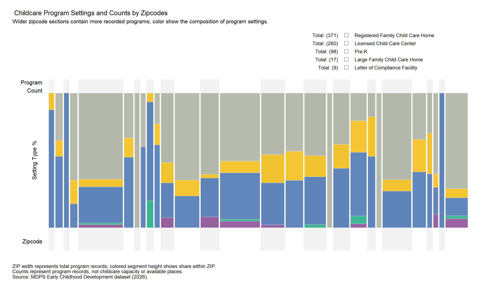

# Final draft
Keaton Green

# MDPS Early Childhood Development:

## Childcare Program Settings and Weekly Schedules

Childcare schedules and programs in Maryland Zipcodes around Baltimore
City can be very fundamentally important to a family’s daily routine.
This project examines how reported operating schedules differ across
program settings (Not type as the overlap of program type made the data
to complex). The focus here is particularly intrested in the examination
between the weekdays and the weekends. It also compares the mix of
settings across zipcodes in the Baltimore area MDPS Early Childhood
Development dataset.

The charts describe program and reported schedules. They do not measure
current vacancies, enrollment, or the actual obtained childcare places
from families. The dataset for this was supplied in 2026; the dates for
the data was collected or updated was not specified.

``` r
library(ggplot2)
library(dplyr)
```


    Attaching package: 'dplyr'

    The following objects are masked from 'package:stats':

        filter, lag

    The following objects are masked from 'package:base':

        intersect, setdiff, setequal, union

``` r
library(tidyr)

childcare_eda <- read.csv(
  "../data/MDPS Early Childhood Dev.csv",
  stringsAsFactors = FALSE
) |>
  filter(
    !is.na(address),
    address != ""
  )

dir.create("../plots")
```

    Warning in dir.create("../plots"): '..\plots' already exists

# Overview of Program Settings

The table here summarizes the number of program records in each setting,
These counts provide the context for the percentage charts: a large
percentage within a small setting does not necessarily show lots more
programs.

| Zipcodes | Program Settings                  | Program Records |
|---------:|:----------------------------------|----------------:|
|    21201 | Licensed Child Care Center        |               7 |
|    21201 | Pre-K                             |               1 |
|    21202 | Licensed Child Care Center        |               9 |
|    21202 | Registered Family Child Care Home |               6 |
|    21202 | Pre-K                             |               2 |
|    21203 | Licensed Child Care Center        |               1 |
|    21205 | Registered Family Child Care Home |              11 |
|    21205 | Licensed Child Care Center        |               3 |
|    21205 | Pre-K                             |               3 |
|    21206 | Registered Family Child Care Home |              57 |
|    21206 | Licensed Child Care Center        |              24 |
|    21206 | Pre-K                             |               5 |
|    21206 | Large Family Child Care Home      |               2 |
|    21206 | Letter of Compliance Facility     |               1 |
|    21207 | Licensed Child Care Center        |              11 |
|    21207 | Registered Family Child Care Home |               7 |
|    21207 | Pre-K                             |               3 |
|    21208 | Registered Family Child Care Home |               1 |
|    21209 | Licensed Child Care Center        |               3 |
|    21209 | Registered Family Child Care Home |               2 |
|    21210 | Licensed Child Care Center        |              11 |
|    21210 | Letter of Compliance Facility     |               3 |
|    21210 | Pre-K                             |               1 |
|    21211 | Licensed Child Care Center        |               8 |
|    21211 | Registered Family Child Care Home |               3 |
|    21211 | Pre-K                             |               2 |
|    21212 | Registered Family Child Care Home |              14 |
|    21212 | Licensed Child Care Center        |               7 |
|    21212 | Pre-K                             |               4 |
|    21212 | Large Family Child Care Home      |               2 |
|    21213 | Registered Family Child Care Home |              33 |
|    21213 | Licensed Child Care Center        |              12 |
|    21213 | Pre-K                             |               6 |
|    21214 | Registered Family Child Care Home |              23 |
|    21214 | Licensed Child Care Center        |              11 |
|    21214 | Large Family Child Care Home      |               3 |
|    21214 | Pre-K                             |               1 |
|    21215 | Registered Family Child Care Home |              41 |
|    21215 | Licensed Child Care Center        |              28 |
|    21215 | Pre-K                             |               7 |
|    21215 | Large Family Child Care Home      |               4 |
|    21215 | Letter of Compliance Facility     |               1 |
|    21216 | Registered Family Child Care Home |              22 |
|    21216 | Licensed Child Care Center        |              15 |
|    21216 | Pre-K                             |              10 |
|    21216 | Large Family Child Care Home      |               1 |
|    21217 | Registered Family Child Care Home |              16 |
|    21217 | Licensed Child Care Center        |              13 |
|    21217 | Pre-K                             |               8 |
|    21218 | Registered Family Child Care Home |              21 |
|    21218 | Licensed Child Care Center        |              16 |
|    21218 | Pre-K                             |               7 |
|    21218 | Letter of Compliance Facility     |               1 |
|    21222 | Registered Family Child Care Home |               1 |
|    21223 | Licensed Child Care Center        |              15 |
|    21223 | Registered Family Child Care Home |              13 |
|    21223 | Pre-K                             |               6 |
|    21224 | Licensed Child Care Center        |              16 |
|    21224 | Pre-K                             |               8 |
|    21224 | Registered Family Child Care Home |               7 |
|    21224 | Letter of Compliance Facility     |               2 |
|    21224 | Large Family Child Care Home      |               1 |
|    21225 | Licensed Child Care Center        |               9 |
|    21225 | Pre-K                             |               5 |
|    21225 | Registered Family Child Care Home |               3 |
|    21228 | Registered Family Child Care Home |               1 |
|    21229 | Registered Family Child Care Home |              38 |
|    21229 | Licensed Child Care Center        |              16 |
|    21229 | Pre-K                             |               5 |
|    21230 | Licensed Child Care Center        |              12 |
|    21230 | Registered Family Child Care Home |              10 |
|    21230 | Pre-K                             |               7 |
|    21231 | Licensed Child Care Center        |               4 |
|    21231 | Pre-K                             |               3 |
|    21231 | Registered Family Child Care Home |               3 |
|    21234 | Registered Family Child Care Home |               6 |
|    21234 | Licensed Child Care Center        |               2 |
|    21234 | Large Family Child Care Home      |               1 |
|    21234 | Pre-K                             |               1 |
|    21236 | Licensed Child Care Center        |               1 |
|    21239 | Registered Family Child Care Home |              32 |
|    21239 | Licensed Child Care Center        |               6 |
|    21239 | Large Family Child Care Home      |               3 |
|    21239 | Pre-K                             |               3 |
|    21239 | Letter of Compliance Facility     |               1 |

Program records by Zipcode and setting. Source: MDPS Early Childhood
Development dataset.

# Program Setting Across Zipcodes

This chart compares the share of program records belonging to each
setting within each Zipcode. Each bar totals 100% , allowing for the mix
to be compiled and show the comparison across places.

Zipcodes with codes with very different numbers of records receive the
same amount of space . The chart is showing the composition rather then
the total number of programs.

``` r
#If ggmosiac isnt downlaoed use this to get it pulling from github.
#install.packages("pak")
#pak::pkg_install("haleyjeppson/ggmosaic")

library(ggmosaic)

program_setting_counts <- childcare_eda |>
  dplyr::filter(!is.na(zipcode),
                trimws(as.character(zipcode)) !="",
                !is.na(gen_program_setting_detail),
                gen_program_setting_detail !=""
                ) |>
  dplyr::mutate(zipcode = factor(zipcode),
                gen_program_setting_detail = factor(gen_program_setting_detail)
                ) |> 
  dplyr::group_by(zipcode, gen_program_setting_detail) |>
  dplyr::summarise(program_records = dplyr::n(),
                   .groups = "drop")
```

``` r
mosaic_legend <-function(data) {list(
  geom_text(data = data,
            aes(x = .69, y = y, label = label),
            hjust = 1, size = 3.5),
  geom_point(data = data, aes(x = .71, y = y, fil = gen_program_setting_detail),
             shape = 22, size = 4, stroke = 0),
  geom_text(data = data, aes(x = .73, y = y, label = gen_program_setting_detail),
            hjust = 0, size = 3.5)
)}
```

``` r
mosaic_data <- program_setting_counts |> 
  dplyr::group_by(zipcode) |>
  dplyr::mutate(total = sum(program_records),
                display_total = pmax(total, 12),
                weight = program_records / total * display_total) |> 
  dplyr::ungroup()

zip_totals <- mosaic_data |> 
  dplyr::distinct(zipcode, total, display_total) |>
  dplyr::arrange(zipcode) |>
  dplyr::mutate(width = display_total / sum(display_total),
                right = cumsum(width),
                left = right - width,
                center = (left + right) / 2,
                alternate = dplyr::row_number() %% 2)

setting_totals <- program_setting_counts |> 
  dplyr::group_by(gen_program_setting_detail) |>
  dplyr::summarise(total = sum(program_records), .group = "drop") |> 
  dplyr::arrange(dplyr::desc(total)) |>
  dplyr::mutate(y = 1.43 - (dplyr::row_number()- 1)* .06,
                label = paste0("Total: (", total, ")")
                )

setting_names <- sort(unique(as.character(program_setting_counts$gen_program_setting_detail)
                             ))

setting_colors <- setNames(rcartocolor::carto_pal(n = length(setting_names), name = "Bold"),setting_names)

program_setting_chart <- ggplot() +
  geom_rect(data = zip_totals |> 
              dplyr::filter(alternate == 1),
            aes(xmin = left, xmax = right, ymin = -.17, ymax = 1.1),
            fill = "gray95") +
  geom_mosaic(data = mosaic_data, aes(x = product(zipcode),
                  fill = gen_program_setting_detail,
                  weight = weight
              ),
 offset = 0,
 color = "white",
 show.legend = FALSE
  ) + 
  geom_rect(data = zip_totals|> dplyr::filter(right < .999),
            aes(xmin = right - .0015,
                xmax = right + .0015,
                ymin = 0,
                ymax = 1),
            fill = "white")+
  
  annotate("text",
           x = c (-.015, -.035, -.015),
           y = c(1.05, .5, -.10),
           label = c("Program\nCount", "Setting Type %", "Zipcode"),
           angle = c(0, 90, 0),
           hjust = c(1, .5, 1), 
           size = 4) +
  mosaic_legend(setting_totals) + 
  scale_fill_manual(values = setting_colors, guide = "none") +
  
  
  
  scale_fill_manual(values = rcartocolor::carto_pal(
    n = dplyr::n_distinct(program_setting_counts$gen_program_setting_detail),
    name = "Bold"
  )
  )+
  
  labs(
    title = " Childcare Program Settings and Counts by Zipcodes",
    subtitle = "Wider zipcode sections contain more recorded programs; color show the composition of program settings.",
    x = "Zipcodes",
    y = "Share of Program Records within zipcodes)",
    fill = NULL,
    caption = paste0(
      "ZIP width represents total program records; colored segment height shows share within ZIP.\n",
      "Counts represent program records, not childcare capacity or available places.\n",
      "Source: MDPS Early Childhood Development dataset (2026)."
    )
  ) +
  
  theme_void() +
  theme(
    legend.position = "none",
    plot.caption = element_text(hjust = 0, size = 10),
    plot.margin = margin(15, 25, 15, 25)
  )
```

    Warning in geom_point(data = data, aes(x = 0.71, y = y, fil =
    gen_program_setting_detail), : Ignoring unknown aesthetics: fil

    Scale for fill is already present.
    Adding another scale for fill, which will replace the existing scale.

``` r
program_setting_chart
```



``` r
ggsave(
  "../plots/green-program-settings-and-counts-by-zip.png",
  plot = program_setting_chart,
  width = 18,
  height = 10,
  dpi = 300,
  bg = "white"
)
```

  
